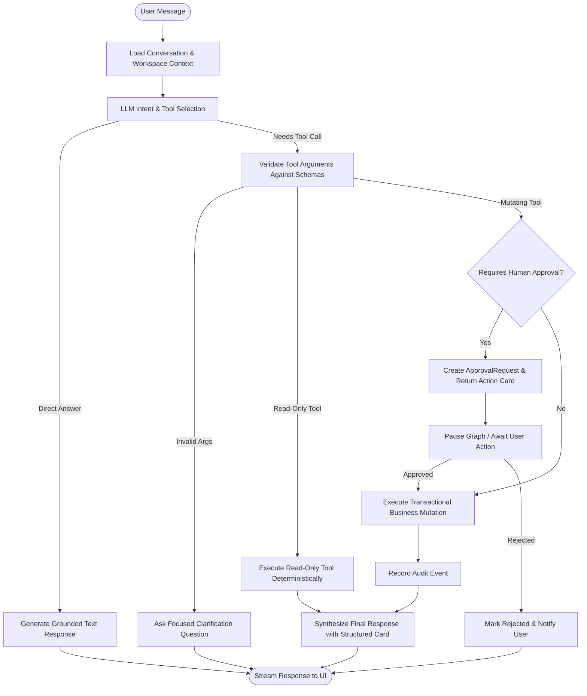

# AI AGENT ARCHITECTURE & TOOL DESIGN: FINPILOT AI

**Orchestration Engine**: LangGraph  
**Model Provider Abstraction**: Anthropic (Claude 3.5 Sonnet / Haiku), OpenAI (GPT-4o), Google Gemini via LiteLLM  
**Architecture Pattern**: ReAct Tool-Calling Agent with Structured Execution and Human-in-the-Loop Approval Checkpoints  

---

## 1. Core Agent Workflows

FinPilot AI separates agent responsibilities into two distinct layers:
1. **The Autonomous CFO Pipeline (`CFOGraphRunner`)**: Batch data ingestion, anomaly detection, runway survival simulations, and board deck generation.
2. **The Interactive Conversational Assistant (`FinPilotAssistant`)**: Real-time conversational agent capable of querying records, interpreting user intentions, calling typed business tools, and pausing for human approval on consequential actions.

---

## 2. Interactive Assistant Graph Architecture

---

## 3. Typed Tool Inventory & Schemas

### 3.1 Read-Only & Query Tools

| Tool Name | Parameters | Returns | Description |
| :--- | :--- | :--- | :--- |
| `search_clients` | `query: str, limit: int = 10` | `list[ClientSummary]` | Search client database by name, company, email, or GSTIN. |
| `get_client_ledger` | `client_id: UUID` | `ClientLedger` | Retrieve outstanding balance, total invoiced, and payment history. |
| `list_invoices` | `status: str = None, client_id: UUID = None, overdue_only: bool = False` | `list[InvoiceSummary]` | Query invoices filtered by status or overdue condition. |
| `get_invoice_details` | `invoice_id: UUID` | `InvoiceDetail` | Full breakdown of line items, tax split, payments, and PDF link. |
| `get_financial_summary` | `period: str = 'current_month'` | `FinancialSummary` | Real invoiced, collected, outstanding, and expense totals. |
| `get_cash_flow_forecast` | `weeks: int = 13` | `ForecastData` | P10/P50/P90 cash forecast bands and projected runway. |

### 3.2 Calculation Tools (Deterministic)

| Tool Name | Parameters | Returns | Description |
| :--- | :--- | :--- | :--- |
| `calculate_invoice_totals` | `line_items: list[LineItemInput], client_id: UUID, discount_total: Decimal = 0` | `InvoiceTotalsPreview` | Computes subtotal, CGST/SGST vs IGST based on client state code, and grand total. |

### 3.3 Mutating Tools (Requires Confirmation)

| Tool Name | Parameters | Consequential? | Approval Gate | Description |
| :--- | :--- | :--- | :--- | :--- |
| `create_invoice_draft` | `client_id: UUID, line_items: list, due_days: int = 15, notes: str = None` | Low | Optional | Creates an uncommitted draft invoice in the database. |
| `issue_invoice` | `invoice_id: UUID, idempotency_key: str` | **High** | **Required** | Moves invoice from Draft to Issued, commits sequential invoice number, and generates PDF. |
| `record_payment` | `client_id: UUID, amount: Decimal, payment_date: date, payment_method: str, reference_number: str` | Medium | Optional | Records a payment entry in the system. |
| `allocate_payment` | `payment_id: UUID, invoice_id: UUID, amount: Decimal` | **High** | **Required** | Allocates payment funds against an issued invoice and updates amounts due. |
| `draft_payment_reminder` | `invoice_id: UUID, tone: str = 'friendly'` | Low | None | Generates personalized payment reminder text with invoice details. |
| `send_payment_reminder` | `invoice_id: UUID, message: str` | **High** | **Required** | Simulates or executes email delivery of payment reminder. |

---

## 4. Grounded Output & Structured Cards

The FinPilot Assistant outputs typed UI payloads alongside conversational text:
- **`InvoiceDraftCard`**: Renders client details, itemized lines, GST tax slab preview, and `Confirm Issue` button.
- **`OverdueSummaryCard`**: Renders table of overdue invoices with age (days past due) and quick-action buttons.
- **`PaymentAllocationCard`**: Displays remaining invoice balance and amount allocated.
- **`ApprovalPromptCard`**: Explicit modal/card showing proposed mutation with Diff, `Approve`, and `Reject` triggers.
