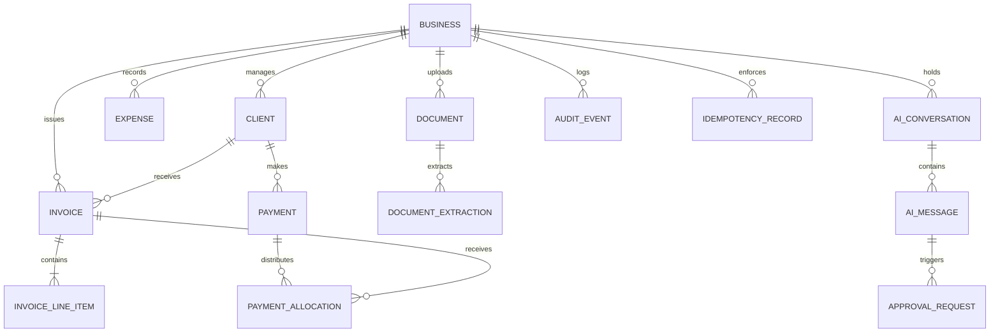

# DATABASE DESIGN SPECIFICATION: FINPILOT AI

**Authoritative Engine**: PostgreSQL 18 (with `asyncpg` in production, `aiosqlite` for zero-config local testing).  
**ORM**: SQLAlchemy 2.0 Async (using typed `Mapped` and `mapped_column`).  
**Migrations**: Alembic.  

---

## 1. Schema Design Principles

1. **Monetary Precision**: All currency amounts use `Numeric(18, 2)` or `Numeric(18, 4)`. Floating point types (`Float`, `Double`) are strictly prohibited for financial balances.
2. **Deterministic Balances**: Every financial entity records explicit currency (`INR`, `USD`, `EUR`) and explicit state.
3. **Transaction Isolation**: Multi-record financial mutations (such as allocating a payment across multiple invoices or issuing an invoice with its line items) execute inside atomic database transactions (`async with session.begin():`).
4. **Foreign Key Integrity**: Explicit foreign keys with appropriate `ON DELETE RESTRICT` for invoices/payments and `ON DELETE CASCADE` for line items.
5. **Idempotency & Auditing**: Dedicated tables for idempotency keys and immutable audit events.

---

## 2. Entity-Relationship Model (New & Integrated Tables)

---

## 3. Detailed Table Specifications

### 3.1 `clients`
- `id`: UUID (Primary Key)
- `business_id`: UUID (Indexed)
- `name`: String(255) (Legal name or contact name)
- `company_name`: String(255)
- `email`: String(255)
- `phone`: String(50)
- `billing_address`: Text
- `state_code`: String(2) (2-digit Indian GST state code, e.g. '27' for Maharashtra, '29' for Karnataka)
- `gstin`: String(15) (Nullable, validated syntactically)
- `currency`: String(3) (Default 'INR')
- `payment_terms_days`: Integer (Default 15)
- `status`: String(20) ('active', 'archived')
- `created_at`: DateTime(timezone=True)
- `updated_at`: DateTime(timezone=True)

### 3.2 `invoices`
- `id`: UUID (Primary Key)
- `business_id`: UUID (Indexed)
- `client_id`: UUID (ForeignKey -> `clients.id`, ON DELETE RESTRICT)
- `invoice_number`: String(50) (Unique per business, e.g. `INV-2026-0001`)
- `invoice_date`: Date
- `due_date`: Date
- `status`: String(30) ('draft', 'pending_approval', 'issued', 'partially_paid', 'paid', 'overdue', 'cancelled')
- `currency`: String(3) (Default 'INR')
- `subtotal`: Numeric(18, 2)
- `discount_total`: Numeric(18, 2) (Default 0.00)
- `tax_type`: String(20) ('intra_state' [CGST+SGST], 'inter_state' [IGST], 'export' [Zero Rated])
- `cgst_amount`: Numeric(18, 2) (Default 0.00)
- `sgst_amount`: Numeric(18, 2) (Default 0.00)
- `igst_amount`: Numeric(18, 2) (Default 0.00)
- `total_tax`: Numeric(18, 2)
- `grand_total`: Numeric(18, 2)
- `amount_paid`: Numeric(18, 2) (Default 0.00)
- `amount_due`: Numeric(18, 2)
- `notes`: Text (Nullable)
- `pdf_path`: String(500) (Nullable)
- `created_at`: DateTime(timezone=True)
- `issued_at`: DateTime(timezone=True) (Nullable)

### 3.3 `invoice_line_items`
- `id`: UUID (Primary Key)
- `invoice_id`: UUID (ForeignKey -> `invoices.id`, ON DELETE CASCADE)
- `description`: String(500)
- `hsn_sac_code`: String(20) (Nullable)
- `quantity`: Numeric(12, 4) (Default 1.0)
- `unit_price`: Numeric(18, 2)
- `discount_pct`: Numeric(5, 2) (Default 0.0)
- `tax_rate_pct`: Numeric(5, 2) (e.g. 18.0)
- `line_total`: Numeric(18, 2) (Computed: quantity * unit_price * (1 - discount_pct/100))
- `tax_amount`: Numeric(18, 2)

### 3.4 `payments`
- `id`: UUID (Primary Key)
- `business_id`: UUID (Indexed)
- `client_id`: UUID (ForeignKey -> `clients.id`, ON DELETE RESTRICT)
- `payment_number`: String(50) (Unique)
- `payment_date`: Date
- `amount`: Numeric(18, 2)
- `currency`: String(3) (Default 'INR')
- `payment_method`: String(50) ('bank_transfer', 'upi', 'cashfree_sandbox', 'razorpay_sandbox', 'cheque', 'manual')
- `reference_number`: String(100) (UTR number, UPI transaction ID)
- `status`: String(30) ('recorded_unsettled', 'settled', 'failed', 'refunded')
- `notes`: Text (Nullable)
- `allocated_amount`: Numeric(18, 2) (Default 0.00)
- `unallocated_amount`: Numeric(18, 2)
- `created_at`: DateTime(timezone=True)

### 3.5 `payment_allocations`
- `id`: UUID (Primary Key)
- `payment_id`: UUID (ForeignKey -> `payments.id`, ON DELETE CASCADE)
- `invoice_id`: UUID (ForeignKey -> `invoices.id`, ON DELETE RESTRICT)
- `allocated_amount`: Numeric(18, 2)
- `allocated_at`: DateTime(timezone=True)

### 3.6 `expenses`
- `id`: UUID (Primary Key)
- `business_id`: UUID (Indexed)
- `date`: Date
- `category`: String(100) ('software', 'contractor', 'office', 'marketing', 'travel', 'equipment', 'taxes')
- `merchant`: String(255)
- `amount`: Numeric(18, 2)
- `currency`: String(3) (Default 'INR')
- `tax_amount`: Numeric(18, 2) (Default 0.00)
- `gstin`: String(15) (Nullable)
- `document_id`: UUID (Nullable)
- `payment_method`: String(50)
- `notes`: Text (Nullable)
- `is_verified`: Boolean (Default False)
- `created_at`: DateTime(timezone=True)

### 3.7 `documents` and `document_extractions`
- Track uploaded receipt / invoice files, storage paths, mime types, OCR extraction text, candidate fields (JSON), and user verification status.

### 3.8 `ai_conversations`, `ai_messages`, `approval_requests`
- Stateful persistence for conversational interactions, tool invocations, and pending human-in-the-loop approvals.

### 3.9 `audit_events` and `idempotency_keys`
- Immutable ledger recording: `timestamp`, `action`, `actor`, `entity_type`, `entity_id`, `before_state`, `after_state`, and cryptographic verification hashes.
- Idempotency records track `key`, `request_hash`, `response_payload`, and `created_at`.
