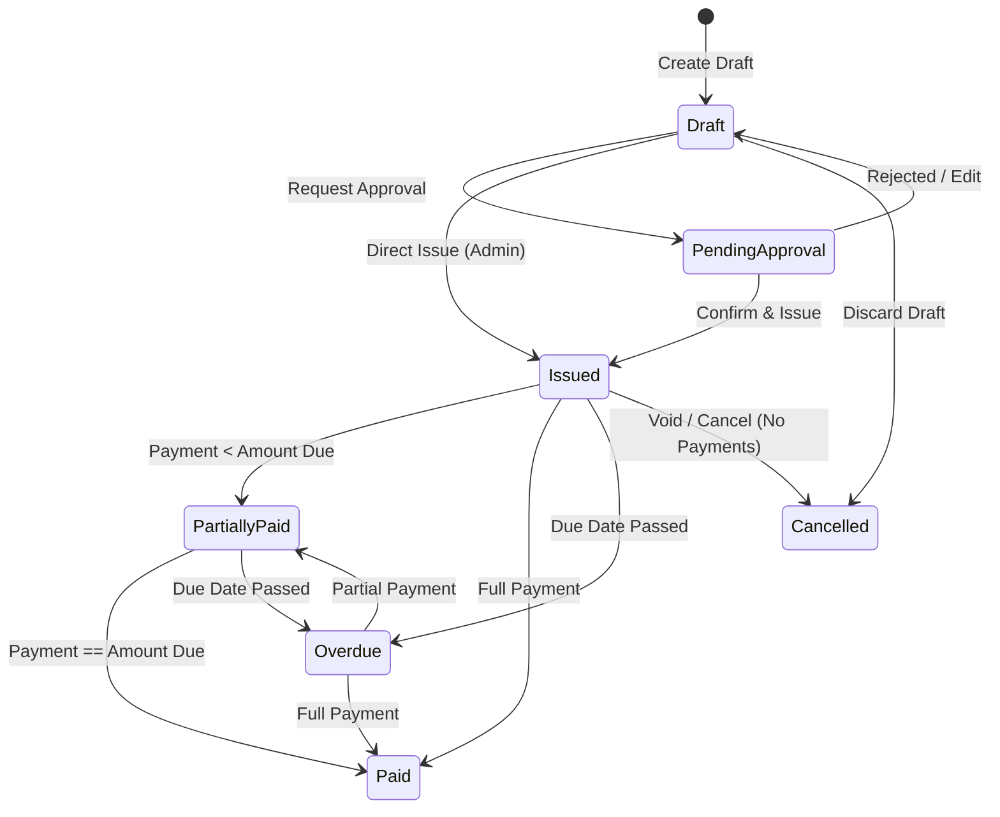

# FINANCIAL CORRECTNESS POLICY & INVARIANTS: FINPILOT AI

**Standard**: Deterministic Precision & Indian GST Regulatory Compliance  
**Authoritative Types**: Python `Decimal`, PostgreSQL `Numeric(18, 2)` / `Numeric(18, 4)`  

---

## 1. Core Financial Rules & Invariants

1. **Floating Point Ban**: Floating point types (`float`, `double`) are strictly prohibited in all authoritative monetary totals, balances, and calculations. Only `decimal.Decimal` is allowed.
2. **Quantization & Rounding**:
   - Currency amounts are rounded to 2 decimal places using `ROUND_HALF_UP` or `ROUND_HALF_EVEN` (Banker's rounding).
   - Taxes are computed per line item and aggregated, or computed on taxable subtotal per tax rate group, avoiding fractional paisa accumulation errors.
3. **No Negative Invoices**: Quantities and unit prices must be strictly non-negative (`>= 0`). Credit adjustments require an explicit credit note or cancellation flow.
4. **Line Item Equation Invariant**:
   $$\text{Line Total} = \text{round}(\text{Quantity} \times \text{Unit Price} \times (1 - \frac{\text{Discount Pct}}{100}), 2)$$
5. **Subtotal Invariant**:
   $$\text{Subtotal} = \sum \text{Line Total}$$
6. **GST Tax Treatment Invariants (India)**:
   - Let $S_{seller}$ be the seller's state code and $S_{buyer}$ be the buyer's state code.
   - If $S_{seller} == S_{buyer}$: Transaction is **Intra-State**:
     $$\text{CGST} = \text{round}(\text{Taxable Amount} \times \frac{\text{Rate}}{2 \times 100}, 2)$$
     $$\text{SGST} = \text{round}(\text{Taxable Amount} \times \frac{\text{Rate}}{2 \times 100}, 2)$$
     $$\text{IGST} = 0.00$$
   - If $S_{seller} \neq S_{buyer}$: Transaction is **Inter-State**:
     $$\text{CGST} = 0.00, \quad \text{SGST} = 0.00$$
     $$\text{IGST} = \text{round}(\text{Taxable Amount} \times \frac{\text{Rate}}{100}, 2)$$
   - Total Tax = $\text{CGST} + \text{SGST} + \text{IGST}$
   - Grand Total = $\text{Subtotal} + \text{Total Tax}$
7. **Invoice Balance Invariant**:
   $$\text{Amount Due} = \text{Grand Total} - \text{Amount Paid}$$
   $$0 \le \text{Amount Paid} \le \text{Grand Total}$$
   $$\text{Amount Due} \ge 0.00$$
8. **Payment Allocation Invariant**:
   For any payment $P$ with total amount $A_P$:
   $$\sum_{i} \text{Allocated}_i \le A_P$$
   $$\text{Unallocated Amount} = A_P - \sum_{i} \text{Allocated}_i \ge 0.00$$
   For any allocated invoice $I$:
   $$\text{Allocated to } I \le \text{Previous Amount Due of } I$$

---

## 2. Invoicing State Machine

### Legal State Transitions
- **Draft -> Issued**: Permitted. Freezes line items, allocates sequential invoice number, generates official PDF.
- **Issued -> Partially Paid**: Permitted upon payment allocation where `allocated < amount_due`.
- **Partially Paid -> Paid**: Permitted when `amount_paid == grand_total`.
- **Issued -> Cancelled**: Permitted only if `amount_paid == 0.00`. If payments exist, they must be unallocated first.
- **Paid -> Draft**: **Illegal**. Completed financial records cannot be reverted to uncommitted drafts.

---

## 3. Disclaimers & Regulatory Transparency

1. **Portfolio / Sandbox Disclosure**: The application explicitly indicates when payments or email reminders are in sandbox / demo mode.
2. **Tax Advice Boundary**: FinPilot provides deterministic calculations based on user-configured GST slabs and state codes. It does not provide certified legal advice or guarantee automated classification without user verification.
